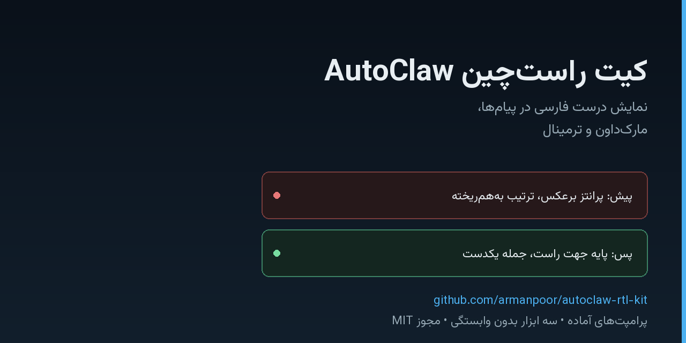

# AutoClaw RTL Kit

**Persian (Farsi) text that reads correctly in chat UIs, markdown and the terminal.**

[](https://github.com/armanpoor/autoclaw-rtl-kit/stargazers)
[](LICENSE)
[](https://www.python.org/)

[فارسی](README.md) · [English](README.en.md)



**Live demo:** [https://armanpoor.github.io/autoclaw-rtl-kit/](https://armanpoor.github.io/autoclaw-rtl-kit/) — paste Persian text and see it fixed.
---

## The problem

Persian renders with correct glyphs but the **paragraph base direction** stays LTR. Unicode's bidi algorithm (UAX #9) then places each right-to-left run relative to a left-to-right starting point. The result looks like this:

- parentheses appear mirrored;
- a Latin filename or hex address jumps to the wrong side of the sentence;
- the second line starts from the left instead of the right;
- list bullets sit on the wrong edge.

Right-aligning the text (`text-align: right`) does not fix it. Only the base direction does (`direction: rtl`, or a wrapper element with `dir="rtl"`).

## What this kit gives you

| Piece | What it does |
|---|---|
| `prompt/autoclaw-rtl-law.md` | A drop-in rule block for `CLAUDE.md` / `AGENTS.md` so an agent always wraps its replies |
| `tools/rtl_wrap.py` | Wraps a document in the RTL container, checks compliance, strips invisible bidi marks |
| `tools/rtl_lint.py` | Pre-flight check: missing wrapper, missing blank line, inline Latin inside Persian sentences |
| `tools/rtl_view.py` | Renders a file (or the clipboard) to a self-contained RTL HTML page |
| `tools/rtl_paddle.html` | A two-pane page: paste messy text on the left, read it correctly on the right |
| `docs/` | Why bidi breaks, editor setup per platform, troubleshooting, glossary |

## Quick start

```bash
git clone https://github.com/armanpoor/autoclaw-rtl-kit.git
cd autoclaw-rtl-kit
python tools/rtl_lint.py --selftest
```

No dependencies. Python 3.9+ only.

## The one-line fix

```markdown
<div dir="rtl">

Your message

</div>
```

Opening tag on its own line, then a **blank line**, the body, a blank line, and the closing tag. The blank line matters: without it the body is treated as raw HTML and your markdown formatting is lost.

## Use it inside an agent instruction file

```markdown
## RTL presentation rule

Every user-facing reply starts with `<div dir="rtl">` on its own line and ends with `</div>`.
Opening tag, blank line, body, blank line, closing tag.
Inline Latin strings go into code spans or `<span dir="ltr">`.
```

Full version with seven sub-rules: [prompt/autoclaw-rtl-law.md](prompt/autoclaw-rtl-law.md).

## Environment support

| Environment | Native RTL | Fix |
|---|---|---|
| AutoClaw chat | right-aligned only | the `dir="rtl"` wrapper |
| GitHub (markdown, issues, comments) | supported since 2021 | [changelog](https://github.blog/changelog/2021-11-16-right-to-left-language-support/) |
| VS Code markdown preview | none | [Persian RTL Markdown Preview](https://marketplace.visualstudio.com/items?itemName=sinatabar.persian-rtl-markdown-preview) or BidiMD |
| Windows Terminal | none ([open issue](https://github.com/microsoft/terminal/issues/538)) | don't read Persian in a terminal — render to HTML |
| Microsoft Word | full paragraph and cell direction | nothing needed |

## FAQ

**Why do parentheses flip?** They are neutral characters; their placement follows the paragraph base direction.

**Isn't RLM enough?** No. A leading RLM only sets the paragraph's first strong character, and it disappears across line breaks. Use RLI/PDI pairs or CSS isolation for inline runs.

**Does it work on macOS and Linux?** Yes. Only `--clipboard` is Windows-specific.

**Will it modify my files?** Only with `--in-place`. Otherwise the result goes to stdout.

## Docs

- [Why text breaks](docs/why-it-breaks.md)
- [Editor and platform setup](docs/editor-setup.md)
- [Troubleshooting](docs/troubleshooting.md)
- [Glossary](docs/glossary.md)

The documentation is written in Persian; code, tests and commit messages are in English.

## License

MIT.
