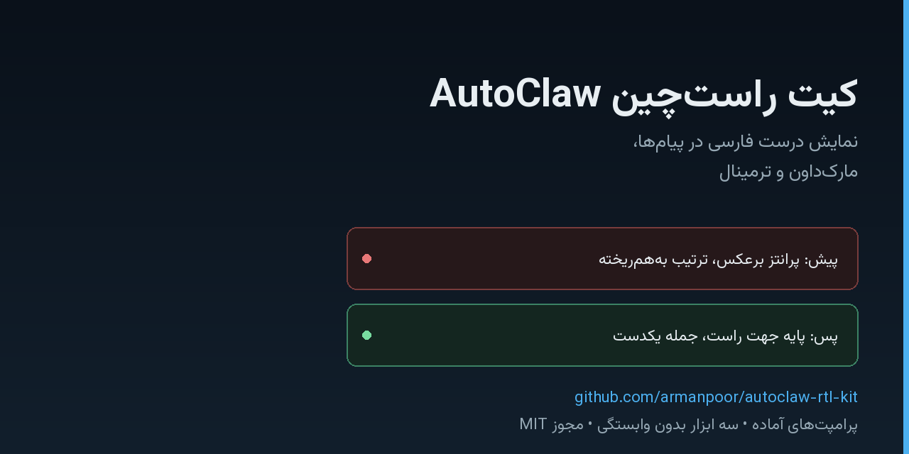

<div dir="rtl" align="right">

# کیت راست‌چین AutoClaw

**نمایش درست فارسی در پیام‌ها، مارک‌داون و ابزارهای خط فرمان.**

[](https://github.com/armanpoor/autoclaw-rtl-kit/stargazers)
[](LICENSE)
[](https://www.python.org/)
[](docs/why-it-breaks.md)

[فارسی](README.md) · [English](README.en.md)



**دموی زنده:** [https://armanpoor.github.io/autoclaw-rtl-kit/](https://armanpoor.github.io/autoclaw-rtl-kit/) — متن فارسی را بچسبانید و درست ببینید.
---

## مشکل چیست؟

فونت فارسی درست رندر می‌شود؛ مشکل از فونت نیست. رندرکنندهٔ پیام، متن را **راست‌تراز** می‌کند اما **پایهٔ جهت پاراگراف** را راست‌به‌چپ نمی‌گذارد. در چنین حالتی الگوریتم دوجهتهٔ یونیکد هر واژهٔ فارسی را درست می‌چیند، ولی ترتیب کل خط، جای پرانتزها و محل بولت‌های فهرست به‌هم می‌ریزد.

نشانه‌های آشنای این نقص:

| آنچه می‌بینید | علت فنی |
|---|---|
| پرانتزها برعکس دیده می‌شوند | پرانتز خنثی است و جهت خود را از پایهٔ پاراگراف می‌گیرد |
| نام فایل یا فرمان لاتین وسط جمله می‌پرد | رشتهٔ لاتین یک «جزیرهٔ چپ‌به‌راست» است و ترتیبش با متن فارسی جمع نمی‌شود |
| خط دوم ادامهٔ جمله را از سمت چپ شروع می‌کند | شکست خط در پایهٔ چپ‌به‌راست انجام شده است |
| فهرست گلوله‌ای در سمت چپ ظاهر می‌شود | نشانگر فهرست تابع جهت بلوک است، نه جهت متن |

## این کیت برای چه کسی است

- کسانی که با دستیارهای هوش مصنوعی فارسی می‌نویسند و پیام‌ها به‌هم می‌ریزد.
- نگه‌دارندگان مخزن که می‌خواهند README فارسی‌شان در گیت‌هاب و ادیتور درست دیده شود.
- تیم‌هایی که خروجی فارسی را به ورد، پی‌دی‌اف یا مستند تبدیل می‌کنند.
- هر کسی که با متن دوجهته (فارسی، عربی، عبری) و رشته‌های لاتین سر و کار دارد.

## شروع سریع

```bash
git clone https://github.com/armanpoor/autoclaw-rtl-kit.git
cd autoclaw-rtl-kit
python tools/rtl_lint.py --selftest
```

بدون نصب هیچ بسته‌ای. پایتون ۳.۹ به بالا کافی است.

## راه‌حل

سه لایه، از سبک‌ترین به کامل‌ترین:

### ۱) قاعدهٔ بدون نصب

هر پیام را در یک بستهٔ جهت‌دار بگذارید. همین یک تگ، مشکل را در بیشتر رندرکننده‌ها حل می‌کند:

```markdown
<div dir="rtl">

متن پیام

</div>
```

تگ آغاز در سطر اول، یک سطر خالی، بدنه، یک سطر خالی، تگ پایانی. سطر خالی اجباری است: بدون آن، بدنه به‌عنوان متن خام نمایش داده می‌شود و قالب‌بندی مارک‌داون از بین می‌رود.

قاعدهٔ آماده برای فایل دستورهای عامل: [prompt/autoclaw-rtl-law.md](prompt/autoclaw-rtl-law.md).

### ۲) ابزار خط فرمان

```bash
python tools/rtl_wrap.py notes.md --in-place   # پیچیدن فایل در بستهٔ راست‌چین
python tools/rtl_wrap.py notes.md --check      # بررسی انطباق (کد خروج ۰ یا ۱)
python tools/rtl_lint.py draft.md              # بازرسی پیش از ارسال پیام
python tools/rtl_view.py notes.md              # تبدیل به HTML و باز کردن در مرورگر
python tools/rtl_view.py --clipboard           # همان کار روی محتوای کلیپ‌بورد
python tools/rtl_guard.py . --write       # بسته‌بندی خودکار همهٔ فایل‌های فارسی
```

### ۳) لوح راست‌چین

فایل [tools/rtl_paddle.html](tools/rtl_paddle.html) را باز کنید: متن را در ستون چپ بچسبانید، ستون راست همان لحظه درست نشان می‌دهد. برای وقتی است که متنِ به‌هم‌ریخته را از جایی کپی کرده‌اید و فقط می‌خواهید بخوانیدش.

### ۴) پیش‌نمایش فایل‌ها در هارنس‌ها

تگ جهت‌دار داخل خود فایل، همراه فایل سفر می‌کند. اگر فایل مارک‌داون بسته‌بندی شده باشد، هر پیش‌نمایشی که مارک‌داون را رندر کند — AutoClaw، VS Code، گیت‌هاب، آبسیدین — آن را راست‌چین نشان می‌دهد. نگهبان، این کار را خودکار می‌کند:

```bash
python tools/rtl_guard.py . --write   # فایل‌های فارسی بدون بسته را بپیچ
python tools/rtl_guard.py . --watch   # پایش پیوسته در حین نوشتن
```

فایل‌های دستور عامل و قطعه‌های پرامپت را در `.rtlignore` بگذارید تا دست‌نخورده بمانند. جزئیات و تنظیم VS Code: [docs/harness-preview.md](docs/harness-preview.md).

## استفاده در فایل دستورهای عامل

اگر AutoClaw یا هر عامل دیگری را با فایل دستور مثل `CLAUDE.md` یا `AGENTS.md` راه می‌اندازید، قطعهٔ زیر را به آن اضافه کنید:

```markdown
## قانون نمایش راست‌چین

هر پاسخ کاربرمحور با سطر `<div dir="rtl">` آغاز و با سطر `</div>` پایان می‌یابد؛
تگ آغاز، یک سطر خالی، بدنه، یک سطر خالی، تگ پایانی.
هر رشتهٔ لاتین درون‌خطی در بلوک کد یا داخل `<span dir="ltr">` ایزوله می‌شود.
```

نسخهٔ کامل با هفت زیربند: [prompt/autoclaw-rtl-law.md](prompt/autoclaw-rtl-law.md).
پرامپت کامل با لحن و قالب پاسخ: [prompt/system-prompt.md](prompt/system-prompt.md).

## چه محیط‌هایی درست می‌شوند

| محیط | وضعیت بومی | راه‌حل این کیت |
|---|---|---|
| AutoClaw (پنجرهٔ گفت‌وگو) | تراز راست بدون پایهٔ جهت | بستهٔ `dir="rtl"` — همین کیت |
| GitHub (فایل مارک‌داون، ایشو، کامنت) | پشتیبانی بومی از سال ۲۰۲۱ | [changelog](https://github.blog/changelog/2021-11-16-right-to-left-language-support/) |
| VS Code (پیش‌نمایش مارک‌داون) | بدون پشتیبانی | افزونهٔ [Persian RTL Markdown Preview](https://marketplace.visualstudio.com/items?itemName=sinatabar.persian-rtl-markdown-preview) یا BidiMD |
| ترمینال ویندوز | پشتیبانی ندارد | [ایشوی باز](https://github.com/microsoft/terminal/issues/538) — خروجی فارسی را در ترمینال نخوانید |
| Obsidian | افزونه‌ای | Persian RTL Smart Direction |
| Microsoft Word | کامل | نیازی به این کیت ندارد |

جزئیات راه‌اندازی هر محیط: [docs/editor-setup.md](docs/editor-setup.md).

## پرسش‌های متداول

**چطور متن فارسی را در AutoClaw راست‌چین کنم؟**
هر پاسخ را داخل `<div dir="rtl">` بگذارید، با یک سطر خالی بعد از تگ آغاز. اگر فایل دستور عامل دارید، همان قاعده را یک‌بار در آن بنویسید تا همیشه اعمال شود.

**چرا پرانتزها در متن فارسی برعکس می‌شوند؟**
پرانتز نویسهٔ خنثی است. تا وقتی پایهٔ جهت پاراگراف راست نشود، مرورگر جای باز و بستهٔ آن را از پایهٔ چپ‌به‌راست می‌گیرد.

**آیا RLM کافی نیست؟**
نه. RLM تنها در ابتدای پاراگراف اثر دارد و در شکست خط از میدان خارج می‌شود. برای رشته‌های درون‌خطی، جفت RLI و PDI یا ایزولهٔ CSS درست‌تر است.

**کد و آدرس هگز را چطور بنویسم؟**
در بلوک کد جدا یا داخل کد درون‌خطی. بلوک کد به‌طور طبیعی چپ‌به‌راست است و ترتیبش به‌هم نمی‌ریزد.

**آیا روی مک و لینوکس هم کار می‌کند؟**
بله. ابزارها فقط پایتون استاندارد می‌خواهند. تنها بخش وابسته به ویندوز، خواندن کلیپ‌بورد در حالت `--clipboard` است.

**چرا ترمینال ویندوز درست نشان نمی‌دهد؟**
پشتیبانی دوجهته در آن هنوز پیاده نشده و درخواستش در فهرست کارهای آینده است. خروجی را به فایل بدهید و در مرورگر باز کنید.

**آیا فایل‌های من تغییر می‌کنند؟**
فقط اگر `--in-place` بدهید. در حالت عادی نتیجه در خروجی استاندارد چاپ می‌شود.

## مستندات

- [چرا متن به‌هم می‌ریزد](docs/why-it-breaks.md) — الگوریتم دوجهته با ارجاع به استاندارد
- [راه‌اندازی ادیتور و محیط‌ها](docs/editor-setup.md)
- [عیب‌یابی](docs/troubleshooting.md)
- [واژه‌نامه](docs/glossary.md)
- [نمونهٔ پیش و پس](examples/before-after.md)

## آزمون

```bash
python tests/test_rtl_presentation.py
```

ده بررسی: قالب بسته، خودتوانی، بازگشت‌پذیری، سالم‌ماندن مارک‌داون، بازرسی متن آزاد، و وجود فایل‌های پرامپت.

## مشارکت

Issue و Pull Request خوش‌آمد است. پیش از ارسال، `python tools/rtl_lint.py` را روی فایل‌های تغییر‌یافته اجرا کنید. راهنمای کامل: [CONTRIBUTING.md](CONTRIBUTING.md).

اگر این کیت به کارتان آمد، یک ستاره بدهید تا دیگرانی که همین مشکل را دارند پیدایش کنند.

## کلیدواژه‌ها

فارسی: راست‌چین، متن فارسی، به‌هم‌ریختن متن، پرانتز برعکس، ترمینال ویندوز، مارک‌داون فارسی، دستیار فارسی، ریمپ ایسیو.

انگلیسی: RTL, right-to-left, Persian, Farsi, Arabic script, bidirectional text, Unicode bidi, UAX #9, markdown RTL, chat UI, AI agent prompts, Windows Terminal, VS Code, Obsidian.

## مجوز

MIT — استفادهٔ تجاری و شخصی آزاد است. جزئیات در [LICENSE](LICENSE).

</div>
